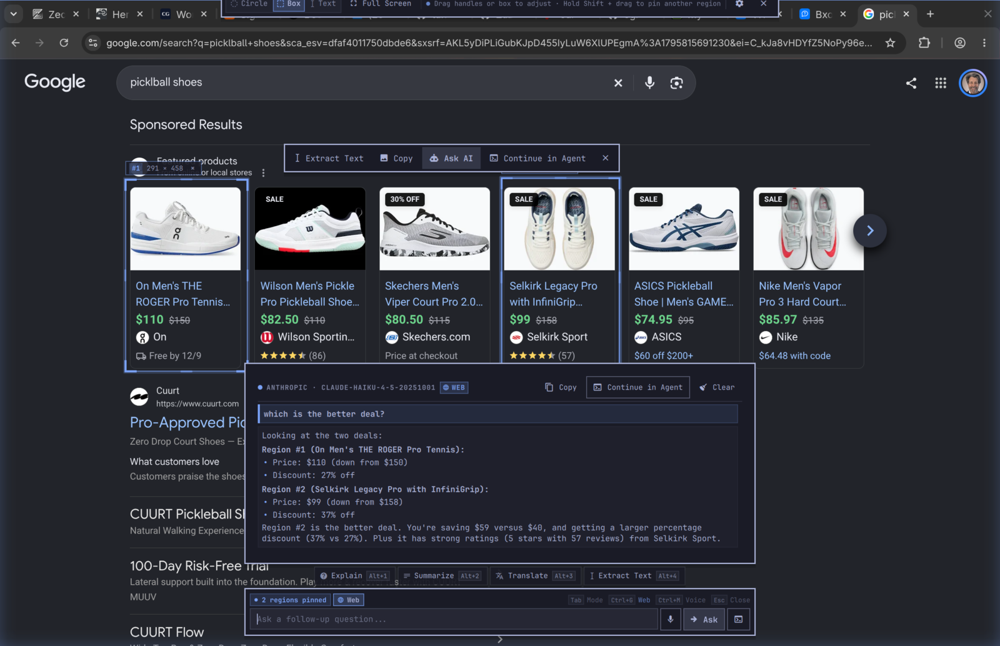
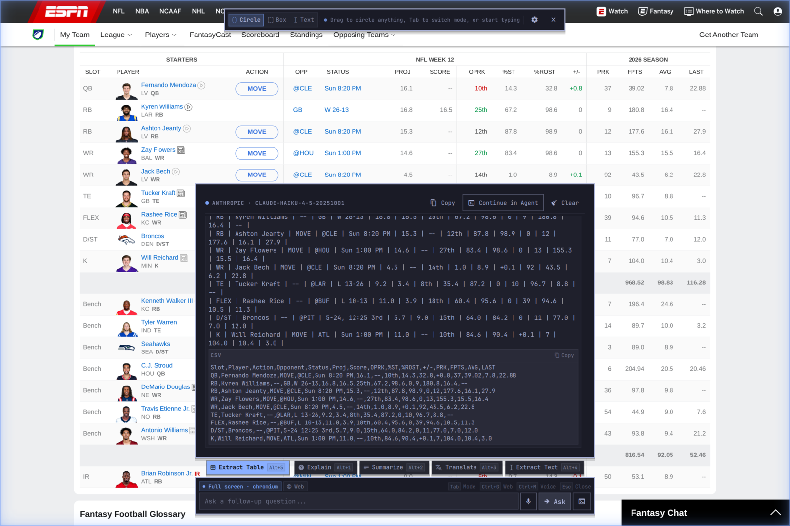
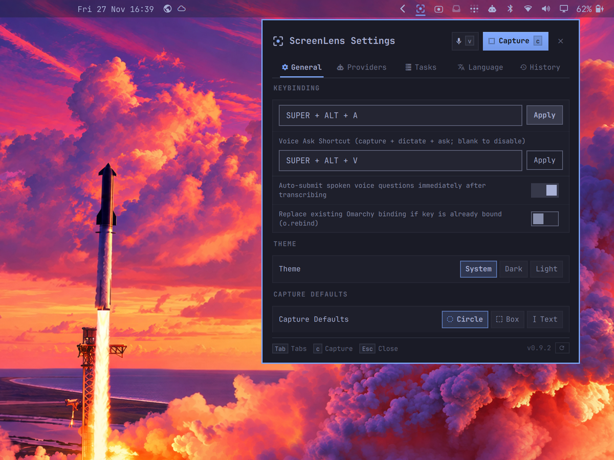
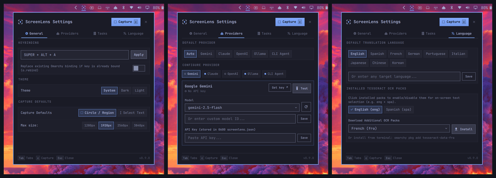

# ScreenLens

An Android "Circle to Search"-style on-screen AI overlay and Settings panel plugin for [Omarchy](https://omarchy.org) (`io.github.cgranier.screenlens`).

Summon ScreenLens over any window or workspace, circle or box one or more regions, select live OCR text, ask out loud hands-free with Superwhisper, and stream fast answers directly from your preferred AI provider—or hand the entire visual context straight off to your Omarchy coding agent.

> **Public Beta (`v0.9.2`):** ScreenLens is in active beta for early Omarchy testers. Bug reports and ideas are very welcome in [Issues](https://github.com/cgranier/screenlens/issues).



## Features

- **Instant On-Screen Overlay:** Summon via hotkey (`Super + Alt + A` by default) or right-click the bar icon without flicker.
- **Circle, Box & Multi-Region Selection:**
  - Switch between **Circle** (freehand lasso), **Box** (draggable rectangle marquee), and **Text** (live OCR selection) via the top bar or `Tab`.
  - Resize and reposition locked selections with live corner/edge handles.
  - Hold **`Shift + drag`** to pin up to 6 numbered regions (`#1`..`#6`) and ask about or compare them in a single prompt.
- **Instant On-Screen OCR Text Selection:** Runs Tesseract word-box OCR in the background as soon as the overlay opens; highlight any visible text, copy (`Ctrl+C`), extract text in 0 ms, or ask AI about it.
- **Quick-Access Voice Ask (`Super + Alt + V`):** Press one hotkey anywhere to capture your screen and immediately start Superwhisper dictation; press again (or `Enter`) to transcribe and auto-ask hands-free. Also supports in-overlay `Ctrl+M` dictation with late auto-paste deduplication.
- **Context-Aware Smart Quick Actions (`Alt+5..6`):** Zero-latency local detection surfaces high-contrast action pills when relevant:
  - **QR / Barcodes:** **Open QR Link** (strict `http://`/`https://` validation) or **Copy QR** (when `zbar` is installed).
  - **Errors & Stack Traces:** **Diagnose & Fix** for tracebacks, compiler errors, and HTTP 4xx/5xx failures.
  - **Tables:** **Extract Table** into a clean Markdown table + copyable fenced CSV block.
- **Customizable Quick-Action Chips (`Alt+1..4`):** Defaults to **Explain**, **Summarize**, **Translate** (using `{{language}}`), and **Extract Text** — customize any slot in **Settings → Actions** with built-in presets (*Fact-Check*, *Draft Reply*, *Review Code*, *ELI5*, *Extract JSON*) or your own prompts, icons, and task routing.
- **Optional Live Web Search Grounding (`Ctrl+G`):** Toggle live web search per question (off by default) with a **`WEB`** badge on grounded answers.
- **Pinned Floating Mini Answer Card (`Ctrl+P`):** Click **Pin** (or press `Ctrl+P`) on any answer to dismiss the fullscreen overlay and float the formatted answer in a draggable, collapsible, click-through corner card (complete with 1-click code-block copy) while you work in underlying apps. Click **`󰁌`** on the mini card anytime to continue the same conversation directly against your **current live screen** — pressing `Esc` keeps or updates the pinned card until you explicitly click `×` to unpin.
- **Instant In-Memory Undo (`Ctrl+Z`):** Accidentally hit `Esc`? Reopen ScreenLens and press `Ctrl+Z` (with an empty prompt) to restore your last dismissed conversation from RAM onto your live screen — zero files written to disk.
- **Hybrid AI Backend + Agent Handoff:**
  - Streams fast direct Vision responses from **Google Gemini**, **Anthropic Claude**, **OpenAI**, or local **Ollama**.
  - Falls back automatically to your **Omarchy CLI Agent** (`claude`, `codex`, `agy`, `opencode`, `grok`, `gemini`, or your Omarchy default) when no direct API key is configured.
  - **Continue in Agent (`Ctrl+Shift+Enter`):** Hands the screenshot, cropped region, selected OCR text, and conversation history to your chosen CLI agent in a terminal.
- **Native Tabbed Settings Panel:** Left-click the bar widget (or click the gear icon inside the overlay) to configure:
  - **General:** Managed Hyprland keybinds (`Super + Alt + A` & Voice Ask `Super + Alt + V`, with backup + `hyprctl` validation & rollback), default selection mode, theme (`System` / `Dark` / `Light` preserving your live Omarchy accent), and max image dimension.
  - **Providers:** Manage API keys (with direct links to provider key pages), discover live available models, select models, and run connection tests.
  - **Tasks:** Optional per-task provider/model routing (**General**, **Vision / Crop**, **Selected Text**, **Translate**) plus a dedicated **Continue in Agent** CLI selector.
  - **Actions:** Customize your 4 quick-action chips (`Alt+1..4`) with 1-click presets, custom icons, prompt templates (`{{language}}`), and task routing, plus toggle contextual smart pills.
  - **Language & OCR:** Pick your default translation language, toggle active Tesseract OCR packs, and install additional Arch `tesseract-data-*` packs directly from Settings.

## Screenshots

### Context-Aware Table Extraction (Markdown + CSV)



### Settings Panel





## Requirements

- Omarchy with the Quattro shell (`omarchy-shell`) and Hyprland.
- Required packages: `grim`, `imagemagick`, `tesseract`, `tesseract-data-eng`, `wl-clipboard`, `python`, `jq`.
- Optional: [Superwhisper](https://superwhisper.com) for voice dictation & Voice Ask; `zbar` (`zbarimg`) for offline QR/barcode decoding; `ollama` for local vision models.

## Install

```sh
omarchy plugin add https://github.com/cgranier/screenlens --enable
~/.config/omarchy/plugins/io.github.cgranier.screenlens/setup.sh
```

`setup.sh` checks required packages (offering to install any missing ones via `omarchy pkg add`) and asks before writing the managed Hyprland keybinds (`SUPER + ALT + A`, plus optional `SUPER + ALT + V` from Settings) to `~/.config/hypr/bindings.lua` and the `no_anim` layer rule to `~/.config/hypr/hyprland.lua`. Pass `--yes` to accept prompts automatically or `--no-binds` to skip Hyprland edits.

> **Tip:** If you skip `setup.sh`, you can still configure both hotkeys anytime from the bar icon → **General → Keybinding** (applying a keybind also ensures the `no_anim` layer rule is set).

### Updating

ScreenLens checks its git remote automatically (cached for an hour; toggleable under **Settings → General**) and shows an **`↑ N`** badge in the bottom-right footer of the Settings panel whenever new commits are available. Click the badge—or press **`Shift+U`** while Settings is open—to review incoming commits, run `omarchy plugin update`, and restart `omarchy-shell` automatically.

You can also update manually from a terminal:

```sh
omarchy plugin update io.github.cgranier.screenlens
omarchy restart shell
```

*(Restarting `omarchy-shell` ensures Qt 6 compiles updated QML fresh from disk.)*

### Uninstalling

```sh
omarchy plugin remove io.github.cgranier.screenlens
```

Then optionally delete:
- The `-- ScreenLens: begin.` … `-- ScreenLens: end.` block in `~/.config/hypr/bindings.lua`
- The `-- ScreenLens layer rule: begin.` … `-- ScreenLens layer rule: end.` block in `~/.config/hypr/hyprland.lua`
- `~/.config/omarchy/screenlens.json`

## Keyboard Shortcuts

| Shortcut | Action |
|---|---|
| `Super + Alt + A` | Toggle ScreenLens overlay (customizable in Settings) |
| `Super + Alt + V` | Quick-access Voice Ask — capture, dictate, and auto-ask (configurable in Settings) |
| `Tab` / `Shift + Tab` | Cycle **Circle** / **Box** / **Text** selection modes |
| `Shift + drag` | Pin an additional region (`#1`..`#6`) in Circle or Box mode |
| `Enter` | Send prompt / follow-up (or stop & ask while voice recording) |
| `Ctrl + G` | Toggle live Web Search grounding |
| `Ctrl + M` | Toggle Superwhisper voice dictation inside overlay |
| `Ctrl + Z` | Restore last dismissed conversation from RAM (when prompt & chat are empty) |
| `Ctrl + P` | Pin latest answer as a floating, non-blocking mini card |
| `Alt + 1..4` | Explain / Summarize / Translate / Extract Text |
| `Alt + 5..6` | Trigger detected Smart Context Action (QR / Diagnose / Extract Table) |
| `Ctrl + C` | Copy selected text, latest answer, or cropped region |
| `Ctrl + Shift + Enter` | Hand off screenshot + text + chat to your coding agent |
| `Esc` | Stop voice / cancel streaming / clear selection / dismiss |

Bar widget: **Left-click** opens Settings (`c` captures, `v` launches Voice Ask), **Right-click** summons the ScreenLens overlay immediately.

## Privacy & Security

- **Local-only secret storage:** API keys saved in Settings are stored exclusively in `~/.config/omarchy/screenlens.json` with `0600` (owner-only) permissions—never in `~/.config/omarchy/shell.json` and never passed in command-line arguments. Environment variables (`GEMINI_API_KEY` / `GOOGLE_API_KEY`, `ANTHROPIC_API_KEY`, `OPENAI_API_KEY`, `OLLAMA_HOST`) are also auto-detected.
- **Zero persistent capture or chat storage:** ScreenLens never saves screenshots or conversation history to disk. Pinned notes and `Ctrl+Z` undo live strictly in RAM for your current session and vanish on unpin or logout; ephemeral `/tmp` captures exist only for the active request and are auto-cleaned.
- **No telemetry:** Screenshots and prompts are sent only to the AI provider or local CLI you explicitly choose.
- **Safe QML rendering:** All dynamic text is rendered through a plain-text wrapper (`PlainText`) to prevent markup injection inside the shell process.

## Development & Testing

```sh
omarchy plugin validate .
node tests/test_logic.mjs
python3 -m unittest -v tests/test_scripts.py tests/test_config.py tests/test_providers.py tests/test_ocr_langs.py tests/test_updater.py
```

For local development installs from a working checkout:

```sh
./bin/install
```

## License

MIT — see [LICENSE](LICENSE).
